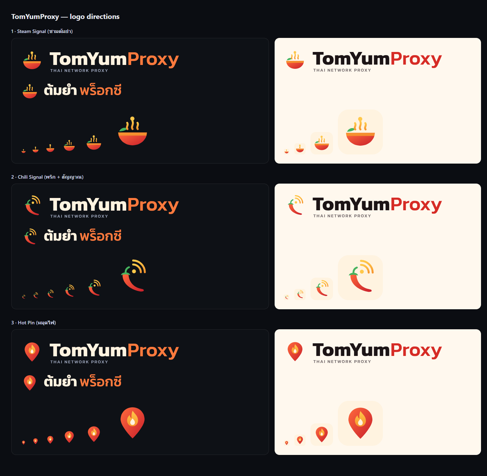

# TomYumProxy — logo directions (proposal, 23 Oct 2026)

**Status: proposal only.** The site still uses the "Proxy Server" brand. These
files are for the owner to choose from before any rename.

Open `board.html` in a browser to see every file at real sizes.

## Concept

The steam of tom yum becomes signal: Thai heat leaving Thailand as connections.

The palette comes from the dish:

| Colour | Hex | Role |
|---|---|---|
| Chili red | `#E8322B` | Brand red; gradient `#FF6A3D` → `#C91F2B` |
| Broth orange | `#F7962E` | Heat, the "Proxy" half of the wordmark |
| Lemongrass yellow | `#FFC84A` | Steam/signal |
| Kaffir lime green | `#46B35E` | Herb accent |
| Coconut cream | `#FFF3E0` | Light background, wordmark on dark |

| Direction | Files | Notes |
|---|---|---|
| **1 · Steam Signal** (recommended) | `bowl-*` | A bowl of tom yum, a kaffir lime leaf, and steam that rises as a signal line ending in a node. It is the most tom-yum-specific mark and tells the name's story. `bowl-favicon-*` is the cut for 16–32 px: one heavy steam line, no leaf. |
| 2 · Chili Signal | `chili-*` | A bird's-eye chili with signal arcs. It is clear at small sizes, but a chili alone can read as Mexican or hot sauce abroad. |
| 3 · Hot Pin | `pin-*` | A location pin (the exit point) with a flame. It is the crispest at 16 px, but the least tom yum, and the flame-in-pin resembles dating and hotspot brands. |

Each direction has the following files:

- `-icon.svg`: the bare mark, 64×64.
- `-tile-dark|light.svg`: an app/favicon tile.
- `-lockup-dark|light.svg`: the icon with the wordmark and the "THAI NETWORK PROXY" tagline.
- `-lockup-th-dark.svg`: the icon with "ต้มยำพร็อกซี".

## Type

The wordmark is Kanit Bold ("TomYum") and Kanit Medium ("Proxy"). Kanit is by
Cadson Demak and licensed under the SIL Open Font License 1.1. The letters are
outlined in the SVGs, so no font is needed to display them.

To regenerate, run `tools/render_logo.py`; its header has the setup.

## Before adopting

Run a trademark search for "TomYum" in Nice classes 38 (telecoms) and 42
(network services) in Thailand and in target markets. Register the domain
(`tomyumproxy.com` and the like) and the social handles together.
