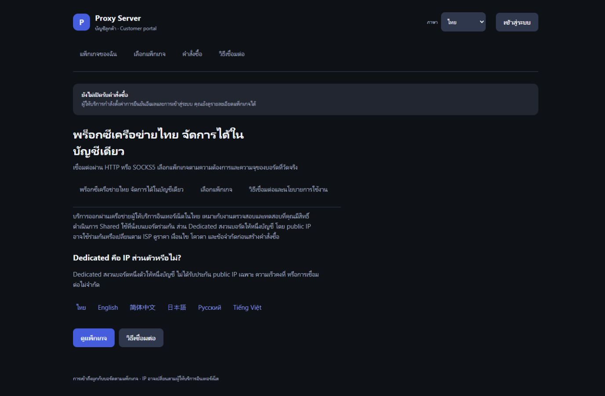

# สรุปงานและสิ่งที่ต้องทำต่อ — 22 ตุลาคม 2026

ระบบ Dashboard Phase 2, งานปรับ Devices/Seat, ระบบขาย และ Portal 6 ภาษา
ทำและ deploy แล้วตามหลักฐานใน repo ส่วนการเปิดรับเงินจริง การส่งข้อมูลเข้า
Analytics/Pixel จริง และการตรวจรับฮาร์ดแวร์ 24 ชั่วโมงยังเป็นงานต่อเนื่อง

เอกสารนี้สรุปภาพรวมให้เจ้าของระบบ ส่วนคำสั่งเริ่มงาน จุดแก้โค้ด และขั้นตอนตรวจรับ
สำหรับ Claude อยู่ใน [Claude continuation handoff](../superpowers/plans/2026-10-22-claude-continuation-handoff.md)

## งานที่ทำแล้ว

| ส่วน | สิ่งที่ส่งมอบ |
|---|---|
| Dashboard Phase 2 | สถานะอุปกรณ์/ผู้ใช้, KPI และ live throughput, metrics/history จริง, events, alerts และ health score พร้อมเหตุผล; refresh รักษาฟอร์ม เมนู focus และ scroll |
| Devices และ Users | ปุ่ม Assign ชัดเจน, แสดง slot/port และจอง slot อัตโนมัติที่แก้ได้, ชื่อเริ่มต้นจาก MAC, แก้ measured speed ใน Settings, โลโก้ ISP พร้อม fallback, รายละเอียดบอร์ดครบโดยไม่ต้องสลับ section tabs และการจัดวางรองรับมือถือ |
| Seat/admission | คิด Seat แยกต่อบอร์ด/MAC แม้ใช้ public IP เดียวกัน; บอร์ด Shared ที่ยังไม่วัดมี 0 seats, วัดเป็นบวกแล้วใช้สูตรที่ตกลง; Dedicated สงวนบอร์ดหนึ่งตัว |
| Health/firmware/flasher | RAM/CPU/flash/RSSI พร้อม unknown/stale, OTA มีขอบเวลาและสถานะยืนยัน, firmware 2.4.25 สำหรับ C3/S3 อยู่สถานะ testing, ปรับหน้า flash ให้เข้ากับ admin และรักษา archive เดิม |
| ระบบขาย | Plans, Orders, Approvals, Subscriptions และ Email log; จอง capacity, ซื้อ/ต่ออายุ, Stripe webhook, โอนเงินแนบสลิปและ admin review, receipt, customer isolation และ durable email outbox |
| ราคาเริ่มต้น | ศึกษาผู้ขายไทยและเตรียม draft Lite 79 / Plus 139 / Dedicated Board 249 บาท, รวม 33 วัน; ยัง inactive เพื่อรอเจ้าของตรวจและเปิดขาย |
| Portal | ไทย อังกฤษ จีนตัวย่อ ญี่ปุ่น รัสเซีย เวียดนาม; 212 keys ต่อภาษา รวม 1,272 translations, รวมสถานะ error วันที่ ตัวเลข THB และหน้าบัญชี/คำสั่งซื้อ/สลิป |
| SEO/OG/SEM | URL แยกภาษา, initial HTML ที่อ่านได้โดยไม่ใช้ JS, title/description/H1/body/FAQ, canonical, hreflang, sitemap 18 หน้า, OG/Twitter 6 ภาษา; keyword matrix, ข้อความโฆษณาร่าง และ CSV export |
| Analytics/Pixel | Settings → Portal marketing จัดการ SEO และ typed ID ของ GA4, Google Ads, Meta Pixel, TikTok หรือ GTM; แยก consent Analytics/Advertising, ถอนความยินยอมได้, ไม่โหลด optional SDK บนหน้าบัญชี/ชำระเงิน/ลิงก์ที่มีข้อมูลอ่อนไหว |

รายละเอียดและหลักฐานแต่ละช่วง: [Phase 2](04-phase2-acceptance.md),
[Platform/commerce/firmware](06-platform-commerce-acceptance.md),
[Portal/SEO/marketing](07-portal-language-seo-sem-analytics.md)
ข้อความสถานะเก่าในรายงานย้อนหลังต้องอ่านพร้อมหมายเหตุที่ supersede แล้ว

## สถานะ deployment ที่ตรวจยืนยันไว้

- Runtime: `7a6f8843e8ff9741de7745fe241b8ce6b66836fa`
- Coolify deployment: `jokgjuch6v5y7lvkjz9iuyjo` — **Success**
- บริการทั้งสี่เริ่มครบ 22 ต.ค. 2026 เวลา **13:25:38 น. (Asia/Bangkok)**
- เอกสาร/หลักฐานก่อนการเขียนสรุปนี้: `8a7294b`; commit เอกสารใหม่ไม่ใช่การ deploy
- เว็บจริง: [Admin](https://admin.jbacteam.com), [Portal](https://admin.jbacteam.com/portal/th/), [Flash](https://flash.jbacteam.com)
- SQLite v8 ตรวจ integrity ผ่าน: users 4, devices 4, plans 3;
  customers/subscriptions/orders ยัง 0 ณ เวลาตรวจ และสัญญาผู้ใช้เดิมไม่เปลี่ยน
- ตั้ง `PORTAL_BASE_URL=https://admin.jbacteam.com/portal/` แล้ว
  ส่วน marketing ยัง `enabled:false` และยังไม่มี provider IDs

นี่คือ snapshot จากการตรวจหลัง deploy รอบดังกล่าว ไม่ใช่การยืนยันสถานะสดตลอดเวลา
Claude ต้องอ่านสถานะจริงใหม่ก่อนทำงานกับ production

## ผลตรวจที่มีหลักฐาน

| การตรวจ | ผลและขอบเขต |
|---|---|
| Admin Go | ล่าสุด 278 cases / 149 top-level tests ผ่านที่ `7a6f884`; vet ผ่าน |
| Race | 278 cases ผ่านบน `8782a12` ซึ่งเป็น Go source เดียวกันก่อนแก้ legacy-entry JavaScript รอบท้าย |
| Broker | tests และ vet ผ่าน; ไม่มีการแก้ broker ในรอบ Portal |
| Browser | Marketing 11 กลุ่ม + commerce/i18n 19 กลุ่มผ่าน; ระบุ source และ fixture แยกใน manifest ไม่ใช่ 30 กลุ่มที่รันทั้งหมดบน commit เดียวกัน |
| ภาษา | helper tests 6 กลุ่มผ่าน; key/placeholder parity, routing และ privacy |
| Production SEO | initial HTML public 18 หน้า, metadata/noindex ของ private 36 URL, sitemap 18 URL; anonymous HTTP หน้า Portal และ robots.txt เป็น 200 |
| UI | ตรวจ DOM viewport 1440×900 และ 375×812, ไม่พบ horizontal page overflow; ภาพ local และ production แยกกัน |
| Design scan | Impeccable ไม่มี non-advisory findings; ยังมี inherited advisories และไม่ใช่ใบรับรอง WCAG ทั้งหน้า |

การทดสอบ Pixel ใช้ SDK จำลองที่ไม่ส่งออกจริง การทดสอบหน้าลูกค้าบางส่วนใช้
intercepted synthetic customer APIs จึงยังไม่พิสูจน์การจ่ายเงินจริง อีเมลจริง
หรือข้อมูลเข้า provider dashboard จริง ดู [ขอบเขตหลักฐาน](evidence-2026-10-22-portal/README.md)

## งานที่ยังต้องทำต่อ

1. **เจ้าของตั้งค่าใน Coolify แล้วแจ้งว่าพร้อมตรวจ** ตามที่ตกลงไว้:
   Stripe, บัญชีรับโอน, Resend และ Turnstile; ไม่ส่ง secrets ในแชตหรือ git
2. **Claude ตรวจ integration บน hostname จริง** หลังพร้อม:
   email/login, Stripe test mode + signed webhook, upload/review สลิป และ
   account/renewal flow โดยไม่ถือ success redirect หรือสลิปเป็นหลักฐานจ่ายเงิน
3. **ตั้ง Analytics/Pixel IDs และตรวจแบบยินยอมจริง** รวม network/provider dashboard,
   การถอน consent, duplicate tags และ provider-side automatic collection;
   ยังไม่มี verified purchase-conversion pipeline หรือ cross-page UTM attribution
4. **ตรวจคำแปลและ SEO ก่อนทำการตลาดจริง**: native-language commercial review,
   Search Console/crawl/indexation และยืนยัน keyword demand; keyword ปัจจุบันเป็น
   editorial hypotheses ไม่มีข้อมูล search volume/CPC หรือคำรับประกันอันดับ
   รายการตรวจเบื้องต้น (AI pre-review ยังไม่ใช่ native sign-off) อยู่ใน
   [09-locale-content-review.md](09-locale-content-review.md) รวมข้อบกพร่องสถานะสลิป
   ที่ต้องแก้ในโค้ด (C1)
5. **อ่านผล soak และตรวจรับฮาร์ดแวร์**: **อัปเดต 22 ต.ค. 16:43** — deploy `d2cc62b`
   (แก้สถานะสลิป C1) ตามที่เจ้าของอนุมัติ ทำให้ run 5 ถูกขัดจังหวะหลังเก็บได้ราว 3 ชม. 15 นาที
   ต้องหยุด recorder เดิมและเริ่ม run 6 บน server (ดู handoff ส่วนที่ 10); ข้อความเดิม: snapshot ล่าสุด run 5 ยังรันอยู่
   เริ่ม 22 ต.ค. 13:26:02 น. คาดครบ duration 23 ต.ค. 13:26:02 น. ถ้าไม่ถูกขัดจังหวะ
   ต้องอ่านผลจริงและประเมินก่อนเรียกว่าผ่านหรือ promote firmware

ยังไม่เปิด campaign หรือใช้งบโฆษณา และยังไม่เปิดรับเงินจริงในรอบนี้
แพ็กเกจ/ชื่อที่ผู้ดูแลกรอก ข้อมูลบัญชี และรายละเอียดลูกค้ายังคงเป็นข้อมูลต้นฉบับ
ไม่ได้แปลอัตโนมัติโดยเงียบ ๆ

## จุดที่ต้องรักษาตอนรับงานต่อ

- กฎ Seat ล่าสุดเป็น **ต่อบอร์ด** ไม่ใช่รวมตาม IP; CPU ต่ำไม่ได้แปลว่ามี capacity ที่วัดแล้ว
- AEC0 measured capacity ปัจจุบันใน snapshot คือ **1.4 Mbps** จาก event วัดที่บันทึกไว้
  เวลา 13:07:18 น. ระหว่าง runtime เก่า; อย่าคืน 2.4 Mbps จาก backup โดยอัตโนมัติ
- ห้ามเปิด serial เพื่อดูสุขภาพ C3 ระหว่าง soak เพราะ DTR/RTS ทำให้บอร์ด reboot
- การ deploy เปลี่ยน broker container; collector ที่ใช้ namespace เก่าต้องจบรอบเดิม
  แล้วเริ่ม output directory ใหม่ อย่านับเวลาหลายรอบรวมเป็น 24 ชั่วโมงต่อเนื่อง
- Firmware 2.4.25 ยัง testing; latest/stable ยัง 2.4.21-mux1.2
- `output/` เป็น untracked local artifacts อยู่เดิม ไม่ใช่งานที่ต้อง commit ทั้งโฟลเดอร์

ภาพจาก Portal production หลัง deploy:

