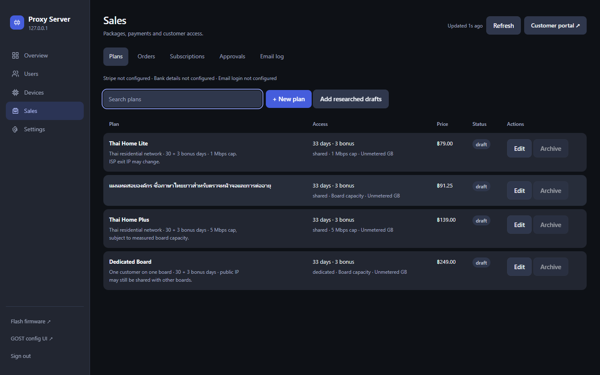
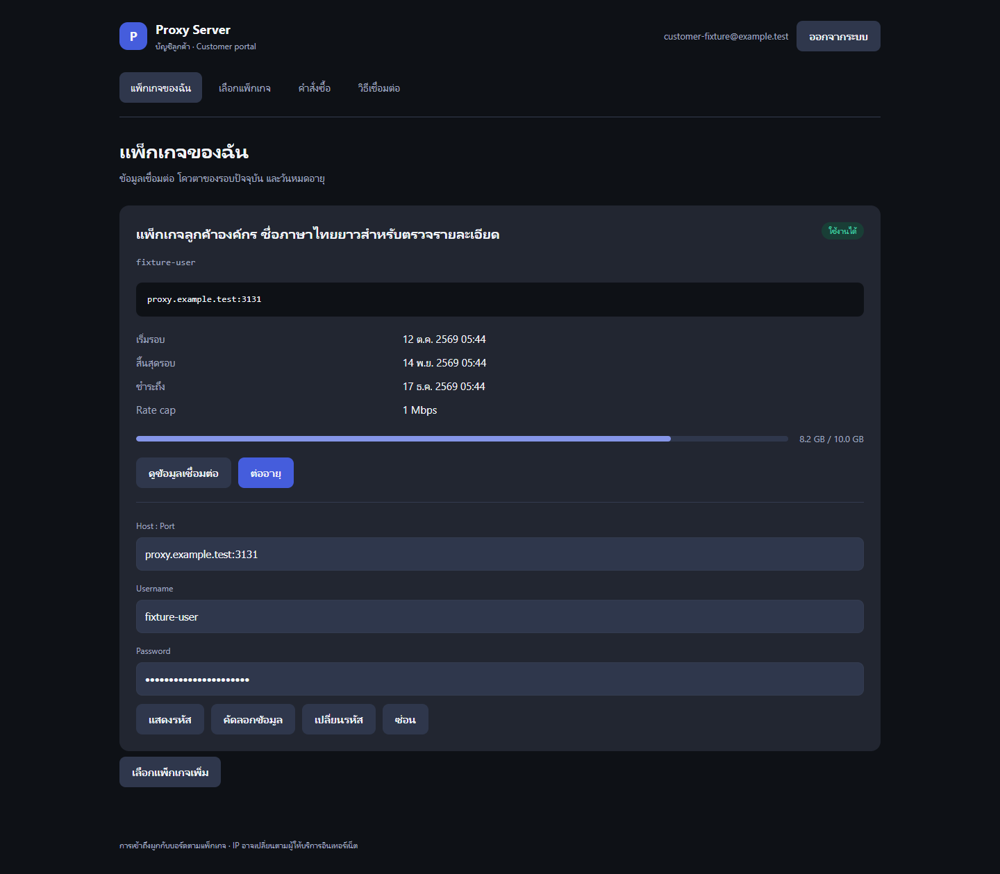

# Local interface evidence

These are local verification screenshots, not production transactions.

- `*-real-api.png`: real Go admin API, isolated seeded SQLite, fake broker/geo.
- `*-intercepted-api.png`: customer UI with explicitly intercepted customer API
  responses. Accounts, usage, credentials and payments shown are synthetic.
- `*-document.png`: repository pricing report render/readback. Competitor
  website observations are attributed in that report, not proved by screenshots.

The complete 13-group browser result is `commerce-acceptance.json`; screenshot
names listed there also include local-only artifacts in `output/playwright/`.
The static Impeccable scan is `impeccable-commerce.json` (88 advisory notes,
no non-advisory findings). Production and hardware results are recorded separately
in [the acceptance report](../06-platform-commerce-acceptance.md).

