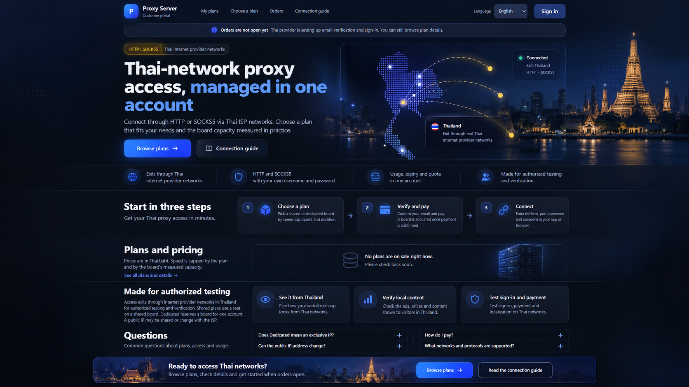

# Proxy Server — Sales Page Redesign
## Design Handoff for Claude Code · UX/UI + Frontend + Conversion Copy + SEO + Accessibility

**Version:** 1.0 · **Prepared:** 23 October 2026 (Asia/Bangkok)  
**Project:** [`n8nhosting/n8nhosting-esp32-exit-node`](https://github.com/n8nhosting/n8nhosting-esp32-exit-node/)  
**Reference branch/commit read:** `main` / `5d5bee4fd9edff5fd27ac9682bb16221ae34d60b` (verify fresh HEAD when starting)  
**Page to redesign:** `https://admin.jbacteam.com/portal/` and locale-specific public home pages  
**Type:** **Implementation-ready design brief**; *not a request to modify production, deploy, activate payment or alter firmware*.  
**Language:** Thai instructions for Claude; English/Thai marketing examples. Six-language implementation requirement.  
**Status of references:** current-page screenshots supplied by the owner; proposed mockup is **conceptual**, not a screenshot of a deployed implementation.

> **One-sentence assignment:** Elevate the existing server-rendered six-language Proxy Server home/sales page to a trustworthy, modern, conversion-oriented SaaS page while preserving the existing Go portal, real plan data, payments/readiness gates, security, localized SEO, analytics privacy, and production operations.

---

## 0. What Claude should read first — non-negotiable

Before editing code:

1. `AGENTS.md` — repository constraints, test process, hardware, Coolify deployment rules.
2. `CLAUDE.md` — official Claude entrypoint.
3. `docs/superpowers/plans/2026-10-22-claude-continuation-handoff.md` — current handoff, activation/hardware evidence and latest appendices. **Revalidate dated snapshots.**
4. `DESIGN.md` and `PRODUCT.md` — approved design system, product truths and language constraints.
5. `docs/dashboard-review/01-ux-ia.md`, `02-frontend-spec.md`, `03-...` **as files actually present** (list the directory first; do not guess paths). Also read `docs/dashboard-review/07-portal-language-seo-sem-analytics.md` and `09-locale-content-review.md`.
6. `admin-api/portal_landing.go`, `admin-api/portal_embed.go`, `admin-api/portal/index.html`, `admin-api/portal/portal.css`, `admin-api/portal/portal.js`, `admin-api/portal/i18n.js`, `admin-api/portal/analytics.js`, and locale JSON files.
7. Inspect the latest Git status, HEAD and changes since `5d5bee4`; preserve concurrent work and all current behavior. Read existing tests before proposing new ones.

**Precedence:** user-approved changes and repository operational rules > verified current runtime/source behavior > this handoff's recommended appearance > generated concept image. If conflict, record and resolve safely; never silently rewrite payment/security rules for visual parity.

**Delivery constraint:** default to **code + local tests + screenshots + review only**. Do **not** push/deploy/Coolify restart, OTA, capacity-measure, alter secrets, start campaigns, or interrupt hardware soak merely for this redesign. Ask owner before any production operation; pushing `main` does not deploy (Coolify is manual-deploy and the stack redeploy can impact broker/ESP32 connections).

---

## 1. Visual reference files (included in this package)

| File | Provenance | How to use |
|---|---|---|
| [`references/current-01-hero.png`](references/current-01-hero.png) | owner screenshot | As-is hero, header, status message, map, CTAs |
| [`references/current-02-steps-and-pricing.png`](references/current-02-steps-and-pricing.png) | owner screenshot | As-is 3 steps, empty plan state and spacing |
| [`references/current-03-usecases-and-faq.png`](references/current-03-usecases-and-faq.png) | owner screenshot | As-is authorized use cases and FAQ |
| [`references/concept-01-redesigned-desktop.png`](references/concept-01-redesigned-desktop.png) | **AI-rendered proposal** | Primary visual direction: hierarchy, density, premium dark mood. **Not pixel-perfect specs or real product state.** |
| [`references/concept-02-claude-handoff-board.png`](references/concept-02-claude-handoff-board.png) | **AI-rendered proposal** | Visual checklist/storyboard only; the written handoff is authoritative. |



**Image caveats:** The generated mockup contains a night-time Thai skyline, glows and sample status/plan imagery. These are **art-direction ideas**, not audited licensed production assets, live node-location evidence, inventory, real metrics, active payment provider, or a connected-user promise. **Never paste the full mockup image as the production HTML UI.** Rebuild using semantic HTML/CSS and the existing inline SVG map; if adding a photo, source/license and optimize a separate asset. No fabricated badges/testimonials/statistics.

---

## 2. Product facts that must not be changed by design

- Service provides access via **HTTP CONNECT and SOCKS5** through Thai internet service provider networks, for **authorized testing and verification**.
- Architecture: customer → GOST → Go broker → ESP32 node over outbound TLS multiplexed `mux1` → ISP connection. This is a *network service*, not a generic VPN or promise of unlimited bandwidth.
- **Shared board:** customer uses a seat on a device with measured capacity; seat calculation and admission are per-board/MAC, **not per public IP**.
- **Dedicated board:** one ESP32 board reserved for one account; **does not guarantee exclusive public IP, static IP, fixed speed or unlimited streams**.
- Actual plan rates are upper limits and also constrained by measured device throughput. Do **not** invent plan prices, uptime, success counts, ratings, provider/ISP inventory, live activity or SLA.
- Plan cards are **server-rendered from active plans**. Unpublished plans are not shown. Empty state must be credible and useful when no plans are live.
- Customer portal has **six locales**: `th`, `en`, `zh-CN`, `ja`, `ru`, `vi`. Customer UI is Thai-first; translation is required for *all* added display strings.
- Public pages have server-rendered HTML + canonical/hreflang/OG/sitemap. Private login, verification, orders, account, payments and token routes must remain private/noindex and exclude optional analytics SDKs.
- Payment/signup/marketing provider integrations are **deployment-configured readiness gates**. The screenshots show the service was not taking orders at capture time. Do not override readiness flags with optimistic client-side UI or create a fake payment flow.
- Actual ESP32 operational detail (stream limits, measured capacity, firmware) belongs in help/specs where relevant, not as universal promises in the hero.

---

## 3. As-is UX audit, from the three owner screenshots

### Strengths worth preserving

- Product headline is accurate: **“Thai-network proxy access, managed in one account.”**
- Page already explains authentication/protocol, measured capacity, shared vs dedicated, authorized use cases, IP caveats, and FAQ.
- Current dark brand (#0E1116 background / #455DDC primary) is aligned with the operator's dashboard.
- Thailand dot-map (`admin-api/portal/landing-map.svg`) is memorable and lightweight; maintain this identity.
- Honesty in the screenshots: “Orders are not open yet” and “No plans are on sale right now.” Keep state-driven messaging.

### Gaps to solve

| Current issue | Visitor impact | Redesign response |
|---|---|---|
| Header is separated into broad lines; “My plans” leads nav for anonymous visitors | Lower initial orientation | Clearly separate public discovery (“How it works”, “Plans”, “FAQ”) and account destinations while preserving all existing routes |
| Hero conveys features but has little contextual storytelling | Value may feel abstract | Tighter headline/CTA cluster + visual narrative of Thai network egress **without claiming live nodes** |
| Three proof items are text-only bullets | Easy to skim past | Compact, semantic benefit strip with icons/text; avoid fake customer logos or trust seals |
| Readiness notice uses internal provider language | Makes the business seem unfinished | Friendly, unambiguous availability banner that still reflects actual backend readiness; show practical next step |
| Empty pricing state is a large nearly blank box | High conversion drop-off | Intentional empty state with useful explanation and link to public plans/help; **no dummy pricing** |
| Benefits / comparison / FAQ are separated by large vertical gaps | Long page with weak cadence | Deliberate sections, consistent rhythm, anchored navigation and bottom CTA |
| Hero “Connected” decoration may appear like real-time availability | Potentially deceptive | Mark map/status as *illustrative* or bind a verified public status endpoint; never imply live connectivity from static art |
| Public page lacks an obvious “why Shared vs Dedicated?” at early glance | Buyer uncertainty | Two concise comparison tiles with caveat near the dedicated message |

**North-star experience:** In the first 5 seconds, a new visitor understands **what it is**, **why Thailand network access matters**, **what protocols are supported**, and **what action is currently available**.

---

## 4. Art direction & design principles

**Concept:** *Premium technical SaaS — Thailand egress network, trust-first, modern, not flashy cyberpunk.*

1. Clear before decorative: bold H1, one core proposition, concise supporting line, dominant first CTA.
2. Product credibility: real constraints visible; no implied enterprise certifications, exclusive IP, static IP or advertised speeds not supported by device measurement.
3. Reuse the approved dark design: modern gradient/sunrise accent **only in marketing hero artwork**; operations/product forms stay tonal and restrained. `DESIGN.md` warns against glowing shadows on the approved console: do **not** spread concept mockup effects into operator UI.
4. Fast/mobile-first: keep the map SVG and optimize any additional image; no large external font/CDN, no page-wide parallax.
5. Accessibility: meaningful semantic elements, high contrast, visible focus, actual 44px targets, reduced motion, clear status messages.
6. Make real states attractive, including no plans, no capacity, payment not ready, unavailable account login, error/loading.
7. Marketing copy remains grounded in authorized QA/localization, not evasive/scam/spam activities.

### Design token contract (start from repo; extend minimally)

| Token / role | Current approved value | Guidance |
|---|---|---|
| `--bg` background | `#0E1116` | Keep at root |
| `--panel` | `#222631` | Cards / sections |
| `--input` | `#2F374C` | Inputs, non-hero controls |
| `--line` | `#343C50` | Dividers / boundaries |
| `--fg` | `#F2F5FA` | Strong text |
| `--muted` | `#A0A9C0` | Body secondary; verify contrast |
| `--primary` | `#455DDC` | Primary actions |
| `--link` | `#8595E8` | Text links |
| `--ok` | `#43D1A7` | **Real** positive state only |
| `--warn` | `#FF862E` | Readiness/warning |
| `--bad` | `#F96589` | Errors |
| `--gold` | `#F3C77A` (existing portal marketing CSS) | Decorative local accent, never simulate payment state |
| Font stack | `"Segoe UI", "Leelawadee UI", "Noto Sans Thai", system-ui, sans-serif` | Reuse; verify all locales/CJK |
| Radius | existing 9px control, 12px panel; landing already uses 20–28px | Keep hierarchy consistent, not random per card |

**Suggested landing-only additions, review in browser:**

```css
/* Design intent, not a drop-in replacement for existing portal.css */
.landing { --landing-max: 1180px; --section-space: clamp(64px, 7vw, 96px); }
.landing .section-shell { width: min(calc(100% - 32px), var(--landing-max)); margin-inline: auto; }
.landing .hero { display: grid; grid-template-columns: minmax(0, 1.05fr) minmax(0, .95fr); gap: clamp(24px, 4vw, 56px); align-items: center; }
.landing .hero h1 { font-size: clamp(2.25rem, 4.2vw, 3.75rem); line-height: 1.13; max-width: 19ch; }
/* Desktop nav and cards must collapse gracefully; honor existing breakpoints. */
@media (max-width: 900px) { .landing .hero { grid-template-columns: minmax(0, 1fr); } }
@media (prefers-reduced-motion: reduce) { .landing *, .landing *::before, .landing *::after { animation-duration: .01ms !important; transition-duration: .01ms !important; } }
```

**Avoid:** replacing all existing CSS variables, adding a new UI framework, overlaying gradient behind every card, loading third-party assets by default, or changing dashboard/admin design beyond this task.

---

## 5. Information architecture / page order

Keep server-side content intact and upgrade visuals rather than reconstructing commerce UX:

```text
PUBLIC HOME: /portal/{locale}/
  01 Site header               brand | public discovery | account | locale
  02 Readiness/status banner   exact state; no forced checkout
  03 Hero                      H1 | proposition | CTA 1 & 2 | Thailand map
  04 Benefit / trust strip     three to four supportable points
  05 Three steps               choose → verify/pay (when available) → connect
  06 Live plans preview        active DB plans or honest empty state
  07 Shared vs Dedicated       two comparison cards + public IP caveat
  08 Authorized use cases      3 QA/localization scenarios
  09 FAQs                      native accessible <details>/<summary>
  10 Final CTA                 plans / connection guide (readiness aware)
  11 Footer + locale links     preserve existing public link structure
```

### Desktop wireframe (concept; 1440px viewport)

```text
┌─────────────────────────────────────────────────────────────────────────┐
│ LOGO  PUBLIC NAV / ACCOUNT NAV             Language  [Sign in]         │
├─────────────────────────────────────────────────────────────────────────┤
│ [i] Availability notice (readiness-aware, non-intrusive)                │
├─────────────────────────────────────┬───────────────────────────────────┤
│ eyebrow: HTTP • SOCKS5 • Thai ISP   │   Thailand SVG network map         │
│ H1 Thai-network proxy...           │   decorative network paths        │
│ lead (2–3 lines)                   │   illustrative info card           │
│ [Browse plans] [Connection guide]  │                                   │
└─────────────────────────────────────┴───────────────────────────────────┘
│  BENEFIT 1      BENEFIT 2       BENEFIT 3       authorized-use note      │
├─────────────────────────────────────────────────────────────────────────┤
│ How it works      [Step 1] → [Step 2] → [Step 3]                      │
│ Plans & pricing   [active, real plan cards OR premium empty state]      │
│ Shared vs dedicated      [shared card] [dedicated + public IP caveat]   │
│ Authorized use cases     [QA] [local content] [sign-in + localization]  │
│ Questions               [real disclosures / no invented SLA]           │
│ Final CTA               [Browse plans] [Guide]                          │
└─────────────────────────────────────────────────────────────────────────┘
```

### Mobile wireframe (360–390px first; also test 320px)

```text
LOGO                          Language
[Account / Sign in]    compact public nav (no dead tabs)
[Readiness message wraps; never clips]
HTTP • SOCKS5 • Thai ISP
H1 (maximum ~5 lines)
Lead (short, readable)
[Browse plans  — full width]
[Connection guide — full width]
[Thailand map — reduced, no text overlay collision]
[Benefit 1]
[Benefit 2]
[Benefit 3]
[1 Choose plan]
[2 Verify/pay]
[3 Connect]
[Plan empty/live cards — one column]
[Shared] [Dedicated]
[Use case cards — stack]
[FAQ — stack]
[Final CTA]
```

**Responsive target grid:** ≥1200 desktop full design, 900–1199 slightly condensed, 720–899 hero stack, 481–719 cards stack/nav adapt, ≤480 single-column touch-first. Use existing breakpoints to minimize regression. Test 320/360/390/768/1024/1280/1440px and orientation, real long Thai/Japanese/Russian strings.

---

## 6. Section-level specifications and acceptance criteria

### 6.1 Header & readiness banner

- Preserve **Proxy Server** brand and locale selector (six language options); sign-in/account links retain real route behavior.
- Public visitors must see accessible links to plans and connection guide. Account links may remain visible but should not overpower the discovery CTA.
- Add skip-to-content/focus handling if not already retained; keep semantic `<header>`, `<nav>`, `<main>`.
- When `login_ready` or commerce availability is false, show a clear, calm message. **Avoid internal implementation copy that implies an error**, but preserve truthful status. Example EN: “Purchases are not available yet. You can explore plans and the setup guide.”; TH: “ยังไม่เปิดรับคำสั่งซื้อในขณะนี้ คุณสามารถดูแพ็กเกจและวิธีเชื่อมต่อได้”.
- Do not hardcode these availability sentences inside HTML/CSS; use the existing localized readiness mechanism and backend config (verify exact states/strings in code).
- Status must be understandable without color; “Coming soon” alone is insufficient. Do not show a checkout CTA when not ready.

### 6.2 Hero (highest priority)

**Layout:** 55/45 copy/art desktop, map below copy on mobile; balanced whitespace, map max-height approximately 480–520px desktop; no cropping of map's southern region.

- Eyebrow: `landing.eyebrow` (localized).
- H1: `seo.home.h1` (server-rendered, exactly one visible H1). **Preserve current validated meaning.**
- Lead: `seo.home.intro` (localized), 1–3 short sentences; don't imply guaranteed capacity.
- Primary CTA: `ui.browse.plans` → `/portal/{locale}/plans`.
- Secondary CTA: `ui.connection.guide` → `/portal/{locale}/help`.
- Right visual: reuse `portalLandingMap()` and `landing-map.svg`, adding subtle layering, path movement only for motion-permitted visitors.
- The current `landing.card.online = Connected` is static and could mislead. Change static decorative wording to an explicit illustration label, **or** connect it to a verified public status signal with proper unknown/offline states and privacy review. Visual change only: prefer **“Thailand network illustration”**; never show synthetic “99.9% uptime”, live sessions, or exact location dots as facts.
- Generated skyline photograph is optional. If used, obtain/create a **standalone optimized asset with rights**, reserve image space, supply decorative `alt=""` and ensure legibility; do not use the complete UI mockup as a background.

**Acceptance:** CTA links localized and clickable with keyboard, H1 present without JS, no horizontal scroll, no false dynamic connection status, no shift after loading.

### 6.3 Benefit strip / proof points

Reuse `landing.proof.1..3`; optional fourth statement is “For authorized testing” **only if localized to all six languages and accurately worded**. Example layout: 3 or 4 evenly spaced icon/label cells on desktop, stack/scroll-free wrap on small screens. Keep text visible without hover; icons are decorative (`aria-hidden="true"`).

### 6.4 How it works / three steps

Reuse `landing.steps.title` and `landing.step.N.*` from locale JSON, with numbered cards/consistent icons. On small screens, naturally stacked vertical sequence. **Crucial:** If orders are not enabled, step 2 must not feel immediately executable; add a localized note/badge “Available when orders open” if copy is approved. Do not silently reinterpret “payment confirmed” as “payment initiated”.

### 6.5 Plans and pricing — database truth, two states

**Live plans:** keep current `portalPlanCard` and active-plan filtering; visually elevate real plan name, price **formatted in baht from satang**, duration, rate cap/board capacity and quota. Make Shared vs Dedicated immediately legible. Use *same plan data*; no new hard-coded plan arrays in JS or markup. Preserve HTML escaping and existing real purchasing route/credentials. Do not show “most popular” without evidence/owner approval.

**No plans:** `len(plans)==0` → premium empty-state container, e.g. icon/illustration, “No plans are on sale right now”, factual subtext, “View plan details / Connection guide” available. Do not show sample prices, placeholders resembling purchasable inventory, countdown clocks or signup capture forms with no backend.

**Capacity:** a speed `rate_mbps` is a cap, not assured achieved speed. No “instant activation” unless backend/provider state and acceptance evidence support it.

### 6.6 Shared vs Dedicated comparison

Keep **two side-by-side cards** with `landing.compare.title`, `landing.shared.*`, `landing.dedicated.*`. Dedicated panel can use subtle gold trim, **not** a gold “exclusive IP” badge. Include source caveat next to the dedicated description: “one board per account, public IP may be shared/changed by ISP, bandwidth constrained by device capacity.” Stack both panels without hidden text on mobile.

### 6.7 Use cases / trust language

Three short cards derived from `landing.usecase.1..3`:

1. View **your own** website/app from Thailand.
2. Check legitimate localized pricing, content, ads displayed to Thai visitors.
3. Test permitted login, payment and localization flows.

No use cases for bypassing controls, fake engagement, account fraud, spam or content scraping without authorization. A concise privacy/legal disclosure may link to existing acceptable-use policy. Do not invent customer logos, security certifications or case studies.

### 6.8 FAQ

Keep native semantic `<details><summary>` with real `seo.home.faq.*` and `landing.faq.2/3.*`. Expand first answer by default if consistent with current HTML. Ensure visible focus, touch-friendly summary height, open/close icons that remain readable in reduced motion. Can add FAQ about supported protocols/billing only after copy approval, source-backed and translated to all six locales. **Do not duplicate a fake FAQ list in JSON-LD**.

### 6.9 Final CTA

One high-contrast but restrained full-width bar/band near end. Prefer “Browse plans” + “Connection guide”, not “Pay now” when orders disabled. If any extra CTA is added, it must link to an actually existing route. Optional skyline graphic may decorate only, never obscure copy or imply presence of physical offices.

---

## 7. Marketing strategy & sample copy (proposal, not automatic publication)

### Buyer and job-to-be-done

- **Primary:** QA, product, localization and compliance teams verifying experiences from networks based in Thailand.
- **Secondary:** developers and product managers who need controlled protocol-based testing endpoints and plan/account visibility.
- **Not promised:** anonymity, unrestricted proxy rotation, guaranteed static residential IP, IP exclusivity, unlimited throughput, bypass capability, or quantified improvement.

### Message hierarchy

1. What: Thai ISP-network proxy access.
2. Why: validate product experiences as viewed from Thailand.
3. How: HTTP CONNECT/SOCKS5; authenticated per customer; usage/expiry/quota visible in portal.
4. Choice: shared seat vs one dedicated board, with IP/capacity caveats.
5. Action: explore real plans or setup guide now; purchase only after readiness.

### Proposed copy variants for review

| Element | English example | Thai example |
|---|---|---|
| H1 (keep current by default) | Thai-network proxy access, managed in one account | พร็อกซีเครือข่ายไทย จัดการได้ในบัญชีเดียว |
| Supporting copy | Test your website, localization and content from Thai ISP networks using HTTP CONNECT or SOCKS5. Choose access based on real board capacity. | ทดสอบเว็บไซต์ การแสดงผล และเนื้อหาสำหรับผู้ใช้ในไทย ผ่านเครือข่ายผู้ให้บริการอินเทอร์เน็ตในประเทศไทย รองรับ HTTP CONNECT และ SOCKS5 โดยเลือกแพ็กเกจตามความจุที่วัดจริง |
| Benefit | Authenticated HTTP / SOCKS5 | HTTP / SOCKS5 พร้อมบัญชีผู้ใช้ |
| Benefit | Plans, usage and expiry in one place | ดูแพ็กเกจ ปริมาณใช้ และวันหมดอายุในที่เดียว |
| Benefit | Shared or dedicated board access | เลือกใช้บอร์ดแบบแชร์หรือเฉพาะบัญชี |
| Availability | Purchases are not open yet. Explore the plans and connection guide. | ขณะนี้ยังไม่เปิดรับคำสั่งซื้อ ดูแพ็กเกจและคู่มือเชื่อมต่อได้ก่อน |
| Primary CTA | Explore plans | ดูแพ็กเกจ |
| Secondary CTA | Read connection guide | คู่มือเชื่อมต่อ |
| Dedicated footnote | Reserved board, not an exclusive or fixed public IP. | สงวนบอร์ดให้หนึ่งบัญชี ไม่ได้รับประกัน Public IP เฉพาะหรือ IP คงที่ |

**Copy process:** Existing locale JSON is the truth of shipped text. Preserve existing key meaning and placeholders; track all proposed changes in a diff and obtain copy review. Generate drafts for the other four languages, but **require native/commercial reviewer signoff** before claiming translation quality or launching localized ads. Refer to `docs/dashboard-review/09-locale-content-review.md` for documented content caveats.

### SEO keyword hypotheses, not measured search-volume data

- EN intent: “Thai proxy”, “Thailand proxy”, “HTTP proxy Thailand”, “SOCKS5 Thailand”, and more specific “Thai network testing proxy”.
- TH intent: “พร็อกซีไทย”, “SOCKS5 ไทย”, “พร็อกซี HTTP ประเทศไทย”, “ทดสอบเว็บไซต์จากเครือข่ายไทย”.
- Use only natural, truthful wording in headings and body. Do not stuff keywords or promise “residential IP” properties the product does not establish.
- Marketing campaign/spend, organic ranking, keyword volume and conversion outcome are **unverified/not part of this task**.

---

## 8. Technical SEO, i18n, accessibility, analytics

### SEO: extend, don't recreate

The code already implements server HTML and, when a valid `PORTAL_BASE_URL` is configured, locale-specific canonical URLs, reciprocal `hreflang`, `x-default`, OG/Twitter metadata and sitemap for public pages. **Do not add duplicate SEO systems.**

- Preserve **one H1**/public page, semantic H2 sections, valuable page HTML without JS, plain anchor links to `/plans` and `/help`.
- Public canonical pages stay `https://admin.jbacteam.com/portal/{locale}/` (or the current configured public base); no canonical based on user-controlled Host headers.
- Preserve `th/en/zh-CN/ja/ru/vi` language URL routing, localized titles and descriptions, OG preview assets, and public-only sitemap scope.
- Private pages (login/verify/account/orders/checkout) remain noindex, no public OG/canonical, no customer data in URL/shared pages.
- Schema structured data only if it is truthful and visible; **FAQPage markup is optional** and rich-result appearance is not promised. Do not add fake Product/Offer/review structured data to empty pricing or inactive plans.
- Public SEO copy may have admin-configurable overrides in Settings → Portal marketing; do not overwrite operator edits or change revision/optimistic-concurrency behavior.
- If updating metadata/OG, use existing generator/workflow (`tools/render_portal_og.cjs` where available) and test images/text per locale.

### Localization

- All new UI/marketing text belongs in locale dictionaries. Keep exact placeholder parity and escape HTML.
- Avoid concatenating sentence fragments for translation. For language-specific line breaks/layout, use CSS rather than `<br>` in translation strings.
- `zh-CN/ja/ru/vi` need layout smoke tests as well as strings; don't assume English width.
- Validate fallback/missing keys, locale switching, persisted locale and canonical navigation.

### Accessibility / responsive success conditions

- Keyboard tab order and visible `:focus-visible`; links look interactive and go to working routes.
- 44×44px touch targets; long forms/data have safe mobile overflow/stacking. Do not hide critical content.
- Contrast target at least **WCAG AA 4.5:1 for normal text**, and 3:1 for larger text/UI boundaries where applicable; test against exact backgrounds.
- Prefer semantic HTML and real `<details>`; map decoration accessible as `aria-hidden` unless it conveys unique information, which must have a text equivalent.
- Screen-reader availability announcement is concise; no live region spam. Motion off with `prefers-reduced-motion`.
- Do not push optional analytics/marketing pixels onto private documents, payment or magic-link/token views. Public opt-in/withdrawal behavior must keep its current privacy boundaries.

### Measurement plan — only after provider configuration and consent

| Event idea | Trigger / caveat |
|---|---|
| Landing view | public page only; consented; manual event if existing tracking supports it |
| Primary CTA click | valid click to `/plans`, **not** a purchase |
| Guide CTA click | valid click to `/help` |
| Plans page view | page actually visited, not inferred from on-page price card |
| Checkout / purchase | **do not claim purchase without server-verified payment transition**, de-duplication and approval |

Before adding events, inspect `admin-api/portal/analytics.js` and existing allowlists/consent revision model; avoid creating a parallel GA4/GTM implementation or new third-party origins. Never publish secrets, email addresses, credentials, tokens, network info or private plan state in analytics payloads.

### Performance budgets (targets, NOT measured results)

- Prefer zero new external runtime dependencies. Keep hero visual as inline existing SVG + small CSS.
- If adding standalone decorative hero photo: responsive formats + width/height/aspect-ratio to avoid CLS; appropriately compressed and served from same origin.
- Target Core Web Vitals **LCP ≤2.5s, CLS ≤0.1, INP ≤200ms** under a defined repeatable lab setup; report actual measurements, never assume.
- Avoid global background video, autoplay, continuous heavy canvas effects and font downloads; CSS/SVG animation must stop for reduced motion.

---

## 9. Code touch map and scope boundaries

| Repository file / directory | Current purpose | Recommended change |
|---|---|---|
| `admin-api/portal_landing.go` | **SSR** hero, steps, active plan cards, comparison, use cases, FAQs and final CTA | Update semantic section wrappers/classes/icon structure and existing locale-key usage. Preserve `portalPlanCard`, escaping and active DB plans. |
| `admin-api/portal/portal.css` | Base portal stylesheet + `.landing` rules and breakpoints | Main style implementation. Namespace redesign to `.landing`, don't restyle private/auth/admin globally. |
| `admin-api/portal/landing-map.svg` | Existing Thailand dot map (embedded inline by Go) | Retain and refine colors/visual composition if needed; no false geographic precision or inferred live node availability. |
| `tools/render_landing_map.py` | Reproducible SVG generator | Change source generator **if** map artwork changes, then regenerate SVG; do not hand-edit generated output only. |
| `admin-api/portal/locales/{th,en,zh-CN,ja,ru,vi}.json` | Locale strings | Add/update only approved copy keys in all six; preserve key parity and formatting. |
| `admin-api/portal/index.html` | Shared portal shell/navigation | Small targeted nav/a11y refinements if required; **do not** break private customer workflow. |
| `admin-api/portal/portal.js` | Account routes, readiness banner, localized navigation and customer actions | Only change for demonstrably necessary link/state UX; never rewrite payment/subscription logic for visual changes. |
| `admin-api/portal_embed.go` | Routes, SSR, SEO head, CSP/analytics boundaries | **Prefer unchanged**. Edit only for a justified and tested SEO/accessibility fix. |
| `admin-api/portal/og/` + OG tooling | Localization-specific social previews | Refresh only if owner approves brand/copy change; preserve generated route/asset behavior. |
| `admin-api/marketing_landing_test.go`, `admin-api/*portal*test.go` | Render/SEO/commerce regression coverage | Add assertions for new sections, active/inactive plans, escaping, 6 languages, no-JS markup and private-boundary behavior. Check actual existing filenames. |
| `tools/portal_i18n_test.cjs`, `tools/portal_marketing_smoke.cjs`, `tools/dashboard_commerce_smoke.cjs` | Locale, marketing and commerce browser tests | Update assertions **only when behavior legitimately changes**. Run suites sequentially if fixtures share paths. |
| `docs/dashboard-review/*` or new design doc | Documentation | Add visual screenshots, copy choices, tradeoffs and QA evidence; preserve dated historical records. |

**Explicitly out of scope:** `firmware/`, `broker/`, GOST proxy authentication/limiting, seat algorithm, SQLite migrations, capacity-measurement logic, Stripe/manual-payment processing, credentials, OTA, admin dashboard redesign, production analytics/SEM activation, Coolify deploy. If testing reveals an unrelated issue, report separately rather than opportunistically refactor it.

### Data/markup guardrails (illustrative only)

- Existing `portalLandingContent(locale, dict, activePlans)` outputs the public home. Reuse it; no React/Vue migration for this sprint.
- Keep `portalPlanCard(locale, p, dict)` as the truth for server-rendered plan cards and escaped customer/operator-entered plan strings.
- Keep `data-photo-slot="hero"` unless intentionally deprecated in a documented migration.
- Do not accidentally produce duplicate `id="publicHeading"`, `landingPricing`, `landingSteps`, `landingCompare`, `landingCta`, or duplicate `<h1>`.
- Preserve current `#publicContent` visible/hidden behavior and server/JS coexistence: `portal.js` should not render a second marketing hero on the home route.
- Do not introduce a generic image source or inline scripts that violate existing CSP (`style-src 'self'`; no blanket `unsafe-inline` or wildcard allowlists).

---

## 10. Execution plan for Claude (small, reversible iterations)

### P0 — Read-only baseline and decisions

- Record `git status`, `git rev-parse HEAD`, plan/readiness states where authorized, and any uncommitted work; **do not read or print secrets**.
- Capture local screenshots of desktop 1440px, mobile 390px and 320px in all six locales if environment supports them; list missing tooling rather than invent test results.
- Compare source-vs-user screenshots. Verify current Go render path, sections, feature flags/empty state, existing test coverage and actual production-deployment status separately.
- Confirm no active device soak/restart-sensitive activity before any deployment request. No deployment authorized by this design handoff.

### P1 — Hero/header/proof

- Improve header information priority, readability of readiness notice, hero hierarchy, two CTAs and 3 proof cards.
- Refine Thailand visual using existing SVG and optional overlay; ensure illustrative status is not falsely called “Connected”.
- Add/maintain accessibility and reduced-motion behavior.
- Render and photograph before/after desktop/mobile. Keep existing route contracts.

### P2 — Steps/plans/comparison/use cases

- Adjust consistent grids, illustrations/icons, desktop/mobile spacing.
- Preserve real active DB plan cards and **zero-plan state**; create fixture coverage for both.
- Keep Shared/Dedicated truth and public-IP caveats next to purchase decision.

### P3 — FAQ/final CTA/content/i18n

- Add restrained, polished FAQ/final CTA. Ensure semantic keyboard interaction.
- Proofread EN/TH and provide locale-diff draft for all six; involve native reviewers for international launch.
- No checkout button if readiness disabled. No new “notify me” form without an actual endpoint/consent policy.

### P4 — SEO/QA/performance / no production deploy

- Verify initial HTML, metadata, canonical/hreflang and private noindex boundaries.
- Run tests below and capture results/screenshots with commit hash and environment.
- Document any design-vs-implementation compromises and prepare a reviewable patch/PR. Ask owner before commit/push/deploy or changes outside agreed scope.

---

## 11. Test matrix / Definition of Done

### Functional states to cover

| Test state | Expected result |
|---|---|
| Anonymous public home / no JS | Complete headline, sections, links, empty/live price cards in HTML |
| Zero active plans | Empty-state message, **no fake cards**, no broken layout |
| At least 2 active plans + 1 inactive | Only 2 actual active plans visible; escaped names; actual THB price |
| Shared/dedicated sample plans | Correct kind and visible caveat; no exclusive-IP promise |
| Login/purchase unavailable | Availability message & non-purchase CTAs; no false success |
| Auth/checkout ready (fixture only) | Existing customer routes, purchase/receipt workflow unchanged |
| Six locale home URLs | Correct language, links, H1/meta/alt text, no missing keys |
| Public ↔ private navigation | Optional analytics SDKs don't cross into account/login/payment documents |
| SEO without JS | One H1, canonical, hreflang, OG when configured; private pages noindex |
| Keyboard/screen reader | Focus visible; FAQ usable; readiness understandable |
| 320/360/390/768/1024/1440px | No horizontal overflow; buttons ≥44px; art text never overlaps |
| `prefers-reduced-motion: reduce` | No moving map, pulsing status or essential motion |
| Slow offline resource / no image | Copy/CTA remains functional; no blank page |

### Suggested local commands (adapt to repo platform instructions)

```bash
# From repo root; inspect AGENTS.md for platform-specific environment settings.
cd admin-api && go test ./... && go vet ./...
# If concurrent/backend behavior was changed: go test -race ./...
cd ..
node --test tools/portal_i18n_test.cjs

# Browser smoke tests require the documented local fixture/Chromium setup.
# Read each script's environment requirements first.
# Run these one after the other, not in parallel, if they share output/playwright/fixture.json:
node tools/portal_marketing_smoke.cjs
node tools/dashboard_commerce_smoke.cjs

# Only if broker was touched (not expected for this design task):
# cd broker && go test ./... && go vet ./...
```

**Important:** A browser fixture, test payment provider, production deployment, hardware pass and live provider event delivery are different evidence categories. Report only what was actually verified. Do not weaken existing assertions just to produce green tests.

### Measurable visual QA

- Desktop and mobile before/after screenshots, plus one public-page screenshot per locale for text wrapping.
- Document computed colors/contrast and real width/height/overflow checks at each viewport.
- Lighthouse/CWV lab numbers optional; when provided, attach configuration and raw results, not unverifiable performance claims.
- No new console errors, CSP violations, missing assets, duplicate H1, blank plan state, broken links, translation-key holes, or mixed public/private analytics.

### Definition of Done

- [ ] Copy and public IP/capacity disclaimers stay factually correct.
- [ ] SSR public home still renders meaningful content without JS.
- [ ] Active plan data and honest empty state both work.
- [ ] All six languages have parity and pass navigation/layout review.
- [ ] Privacy, payment readiness, login/verification and subscription logic unchanged.
- [ ] Tablet/mobile accessibility tested (including 320px, keyboard, reduced motion).
- [ ] Existing tests pass; additional tests cover new markup.
- [ ] Before/after images and diff summary included in delivery.
- [ ] No unapproved production deploy/OTA/secret exposure.

---

## 12. Risk log / safeguards

| Risk | Severity | Mitigation |
|---|---|---|
| AI visual “Connected” mistaken for live network | High | Replace with “Illustrative”/verified state; no fake operational dashboard |
| Fake pricing, bandwidth, inventory, testimonials | High | Render only DB-backed active plans; display genuine empty state |
| Server Go output and JS duplicated | High | Keep SSR as source, portal.js only app/readiness; test no-JS and JS |
| Locale key drift and broken CTA URLs | High | Six-locale parity + route smoke; native copy QA before launch |
| CSP/consent/private-session leak | High | Preserve current public/private navigation, CSP, analytics scope |
| Overwriting marketer SEO overrides / canonical | High | Reuse existing SEO engine; test settings revision/route metadata |
| Visual-only changes mutate checkout/payments | Critical | Hard out-of-scope, run commerce regression suite |
| Deployment interrupts broker/soak/ESP32 | Critical | No default deploy; owner approval and operational runbook first |
| Large imagery / animation harms mobile performance | Medium | Prefer SVG/CSS; lazy decorative media; respect reduced motion |
| Mockup taken literally despite existing design tokens | Medium | Treat visual as inspiration, keep source `DESIGN.md` authoritative |

---

## 13. Handoff output format Claude must provide

At end of implementation, deliver in Thai:

1. **Executive summary** — what changed and the benefit to first-time visitors.
2. **Files changed** — exact file list + purpose; explicitly list files deliberately not touched.
3. **Design before/after** — links to actual desktop/mobile screenshots, not AI-generated concept images misrepresented as output.
4. **Product truth & copy changes** — all new/edited locale keys and factual caveats.
5. **Tests/QA** — commands, pass/fail, commit/fixture/version, viewport sizes, known gaps.
6. **Security/SEO/privacy impact** — canonical/noindex/CSP/consent and checkout unchanged (if proven).
7. **Deployment status** — explicitly “not deployed” unless a separate owner-approved operation has been executed and verified.
8. **Open questions/decisions** — only genuinely owner-dependent items (e.g., approval of any standalone hero photo, native copy signoff, final CTA when opening sales).

---

## 14. Ready-to-paste Claude Code starting prompt

> You are continuing work on `n8nhosting/n8nhosting-esp32-exit-node`. This task is a **sales-page design implementation only**. Read `AGENTS.md`, `CLAUDE.md`, the newest continuation handoff and `DESIGN.md`/`PRODUCT.md` before making changes. Then read this `DESIGN_HANDOFF.md` and inspect all screenshots in `references/`, distinguishing *owner screenshots* from *AI concept images*. Verify current git HEAD and any existing work. Implement prioritized P1–P4 as small changes to the existing Go SSR portal and its CSS/locale JSON, **without** replacing its framework or touching firmware/broker/seat assignment/payments. Preserve honest empty pricing, no forced commerce activation, public/private analytics boundaries, localized SEO, and all six languages. Run relevant Go + browser smoke regression tests sequentially where needed. Deliver actual before/after desktop/mobile evidence, changed files, test logs and a concise Thai summary. **No commit/push/deploy/OTA/Coolify changes unless separately authorized by the owner.**

---

## 15. Source-of-truth links and provenance

**Repository source (inspected for this handoff):**

- [Repo `main`](https://github.com/n8nhosting/n8nhosting-esp32-exit-node)
- [`DESIGN.md`](https://github.com/n8nhosting/n8nhosting-esp32-exit-node/blob/main/DESIGN.md)
- [`PRODUCT.md`](https://github.com/n8nhosting/n8nhosting-esp32-exit-node/blob/main/PRODUCT.md)
- [`CLAUDE.md`](https://github.com/n8nhosting/n8nhosting-esp32-exit-node/blob/main/CLAUDE.md)
- [`admin-api/portal_landing.go`](https://github.com/n8nhosting/n8nhosting-esp32-exit-node/blob/main/admin-api/portal_landing.go)
- [`admin-api/portal/portal.css`](https://github.com/n8nhosting/n8nhosting-esp32-exit-node/blob/main/admin-api/portal/portal.css)
- [`admin-api/portal_embed.go`](https://github.com/n8nhosting/n8nhosting-esp32-exit-node/blob/main/admin-api/portal_embed.go)
- [`admin-api/portal/locales/en.json`](https://github.com/n8nhosting/n8nhosting-esp32-exit-node/blob/main/admin-api/portal/locales/en.json)
- [`admin-api/portal/locales/th.json`](https://github.com/n8nhosting/n8nhosting-esp32-exit-node/blob/main/admin-api/portal/locales/th.json)
- [`docs/dashboard-review/07-portal-language-seo-sem-analytics.md`](https://github.com/n8nhosting/n8nhosting-esp32-exit-node/blob/main/docs/dashboard-review/07-portal-language-seo-sem-analytics.md)
- [`docs/dashboard-review/09-locale-content-review.md`](https://github.com/n8nhosting/n8nhosting-esp32-exit-node/blob/main/docs/dashboard-review/09-locale-content-review.md)

**Visuals:** three owner-provided screenshots, two AI-generated design concepts, included under `references/`.  
**External research:** no claim of live page inspection, current keyword search volumes, ranking, ads spend, third-party trust credentials, production payment activation, or completed hardware stress test is made by this handoff.  
**Permissions:** this file **does not authorize** code push, production deployment, provider activation, payments, OTA, or access to sensitive credentials.

*End of Design Handoff v1.0.*
